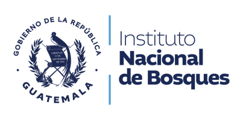
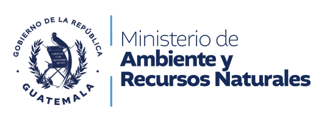
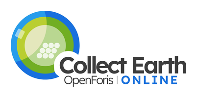
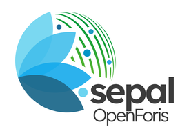
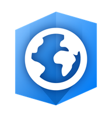

# DINAMICA-COBERTURA-FORESTAL-2020-2024

  
  &nbsp;&nbsp;&nbsp;
  
  &nbsp;&nbsp;&nbsp;
  
  &nbsp;&nbsp;&nbsp;
  

---

  
  &nbsp;&nbsp;&nbsp;
  
  &nbsp;&nbsp;&nbsp;
  
  &nbsp;&nbsp;&nbsp;
  

---

Este repositorio consolida la infraestructura computacional, metodologías y algoritmos aplicados por el Instituto Nacional de Bosques (INAB) para la generación del Mapa de Dinámica de la Cobertura Forestal de Guatemala (Período 2020–2024).

Con el propósito de garantizar la transparencia, reproducibilidad y rigor técnico del monitoreo forestal nacional, se integran tecnologías de procesamiento masivo en la nube (Google Earth Engine, SEPAL) con flujos analíticos avanzados en GEE, SEPAL, Python y automatización geoespacial en ArcPy.

Pilares Técnicos y Metodológicos:
- Detección de Pérdidas Forestales: Implementación de algoritmos de series temporales continuas (CCDC sobre constelaciones Landsat 8 y 9) para la captura precisa de eventos de deforestación y degradación.
- Identificación y Calibración de Ganancias: Fusión de índices espectrales de vegetación y humedad (NDFI, EVI) combinados con datos de radar de apertura sintética (Sentinel-1 C-SAR) y calibración estadística pareada no paramétrica (Prueba de Wilcoxon) para mitigar falsos positivos.
- Estandarización y Filtrado Espacial: Aplicación de reglas de vecindad espacial para homologar la Unidad Mínima de Mapeo (UMM de 0.5 hectáreas), garantizando coherencia con las definiciones forestales nacionales y de la FAO.
- Validación y Estimación de Áreas (Buenas Prácticas IPCC / FAO): Protocolo de inferencia y diseño muestral estratificado probabilístico implementado bajo el marco AREA2 (Olofsson et al.), permitiendo reportar estimaciones de superficie ajustadas por error temático con sus respectivos intervalos de confianza y matrices de confusión validadas.

## Anexos de Código

- **Anexo 1 — Estimación de muestras (Google Earth Engine):** [`anexos/Anexo_1_Estimacion_Muestras.js`](anexos/Anexo_1_Estimacion_Muestras.js) ([Script en GEE](https://code.earthengine.google.com/9b8c956c7271147e20ae3a46fc848d44))
- **Anexo 2 — Proceso de limpieza de las pérdidas (ArcPy):** [`anexos/Anexo_2_Limpieza_Perdidas.py`](anexos/Anexo_2_Limpieza_Perdidas.py)
- **Anexo 3 — Proceso de limpieza de las ganancias (ArcPy):**
  - Tratamiento de ganancias: [`anexos/Anexo_3_1_Limpieza_Ganancias.py`](anexos/Anexo_3_1_Limpieza_Ganancias.py)
  - Limpieza de píxeles (0.5 ha): [`anexos/Anexo_3_2_Limpieza_Pixeles_05ha.py`](anexos/Anexo_3_2_Limpieza_Pixeles_05ha.py)
- **Anexo 4 — Parámetros de detección de ganancias (Google Earth Engine):** [`anexos/Anexo_4_Parametros_Deteccion_Ganancias.js`](anexos/Anexo_4_Parametros_Deteccion_Ganancias.js)
  - [Extracción de índices para calibración de umbrales (GEE)](https://code.earthengine.google.com/07ac4bb3a41dd97fbe9c9c0afc7c9861)
  - [Calibración de parámetros de ganancias v8 (Google Colab)](https://colab.research.google.com/drive/1yUQGXr6IiBvs2vLAhMI0NrbA5kCJd6ir?usp=sharing)
  - [Detección de ganancias 2020–2022 (GEE)](https://code.earthengine.google.com/623f59573e3bcd275d61f6de18a5560d)

